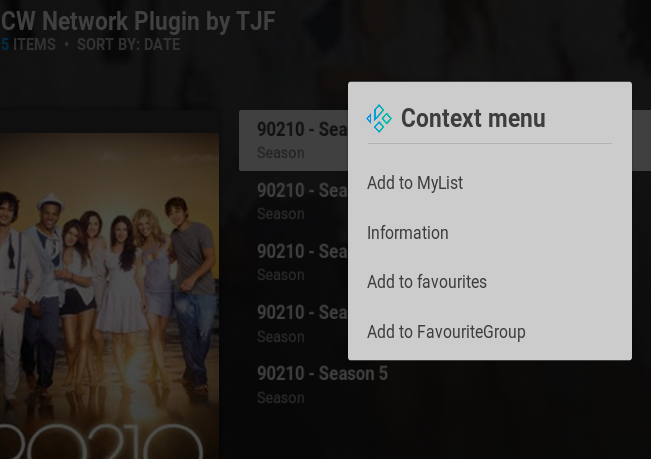

### Kodi Plugin Addon to Access and Play Content from the CW Network (cwtv.com)

Note: This addon only accesses publicly available content and information.

This addon supports Kodi navigation of the content on the CW Network and can utilize the selenium module to play the content in a full-screen browser from the cwtv.com website.

**This plugin version 1.0 is Kodi Piers 22+ only, due to the dependency on the selenium 4.50.0 library.**

*Note: There is a version of this plugin that works on Kodi Omega with the selenium 4.15 library, but it involves a substantial amount of hand-editing ini files and manual building of the selenium dependency. There is also a requirement that an external player be used. For these reasons the Omega 21 plugin is available only upon request.*

#### Installation in Kodi:

<u>Method 1: From the TJF Repository</u>

Repository link:  https://fillimerica.github.io/kodirepo/

1. Enable "Unknown Sources" in Kodi Settings > System > Add-ons
2. Add the TJF Repository to the Kodi Sources in the Kodi File Manager
   1. Go to Settings > File manager
   2. Select "Add source" in either pane.
   3. Copy and paste (or type) the repository link listed above into the larger "Enter path..." edit box.
   4. In the smaller edit box under "Enter a name for this media source.", give the repository link a meanigful name such as "TJF Repository"
   5. Select OK to save this source.
3. Install the Repository as an add-on:
   1. Go to Settings > Add-ons
   2. Select "Install from zip file" (NOT install from repository at this point)
   3. In the "install from zip file" dialog, select the source that was added in step #2 above.
   4. A single zip file should appear in the list, select it to install the TJF Repository.
4. Install the CW Network Plugin add-on from the TJF Repository
   1. Go to Settings > Add-ons (if not already there)
   2. This time choose "Install from repository", and select the "TJF Repository" from the list.
   3. Choose "Program add-ons" from the category list.
   4. Choose "CW Network Plugin" from the list. The CW Network Plugin add-on will be installed.

<u>Method 2: From the Github Code Source</u>

Github link:  

1. From the github project repository, click on the green Code button and choose the "Download ZIP" option.
2. Depending on your browser configuration you may be prompted to choose a download location and/or a file name. In some configurations this is bypassed in favor of automatic downloading into a designated Downloads folder. In either case make sure the zip file that is downloaded is copied or moved into a location that Kodi can access in the Kodi File Manager.
3. Enable "Unknown Sources" in Kodi Settings > System > Add-ons
4. Install the CW Network Plugin add-on:
   1. Go to Settings > Add-ons
   2. Select "Install from zip file"
   3. In the "install from zip file" dialog, select the zip file that was downloaded in step #2 above. The CW Network Plugin add-on will be installed.

### Configuration

There is no configuration required for this plugin. However the selenium dependency does require configuration. Refer to the readme for the script.module.selenium addon for more information.

#### Usage

Run the CW Network Plugin from the Video Add-ons, or add to favorites, or add to the GroupFavorites Addon, or add to your skin menu.

This addon behaves like a standard content-driven Kodi Video addon. There are a few special features of note:

1. There is a built-in MyList group internal to the add-on that can be used to save recently accessed series, seasons, movies, or episodes for fast direct access. This avoids having to go out and re-scrape the cwtv website every time. Access MyList features by bringing up the context menu on an item of interest and selecting the MyList option. For Example:

   

2. The addon caches episode and season data in the kodi userdata folder so that subsequent access to non-current seasons are served from the cache rather than the cwtv website. Cache management is fully automatic, but if for some reason the data for a particular series is incomplete deleting the cache file with the same name as the series should resolve the issue.

   #### Notes on the Integrated Web Playback System

   The CW Network uses DRM protected advertising supported playback witin their website. Decoding the stram files and enabling playback through inputstream is way beyond the devveloper's capabilities, so I have resorted to using selenium to control and format the local web browser to support full-screen playback. As a result there are a few visual behaviors that are to be expected using this approach:

   1. A non-headless (visual and uesr controllable) web browser instance is instantiated at the start of playback. The web browser window will start in a window and only cover a portion of the screen.

   2. As the underlying selenium script progresses, the web browser will be re-formatted to have playback fill the entire screen focused on the brightcove video player that the CW Network currently uses for playback.

   3. In most cases the video will playback automatically. If the video was interrupted before the show was finished, in many cases playback will start where it previously left off, rather than the beginning.

   4. In some cases the selenium script may get out of sync with the website and the video may not start, or doesn't fill the screen, or is muted. These issues can be corrected on mouse driven systems by using the player's controls at the bottom of the screen. On systems without mouse control, exiting and then re-selecting the episode usually fixes the problem.

   5. The script tries to anticipate and work around web page loading issues but timing may still be a problem on some systems. Faster computers tend to work more reliably than slower or resource constrained ones.

   #### Disclaimer of Perpetual Support

   **While a best-effort will be made to keep the plugin working with the CW Network website and content, the addon may cease working with no notice nor a resolution.** 

   The CW network may decide to re-format the way their show data is presented and may decide to move the data behind a login or paywall in the future causing the addon to stop functioning.
