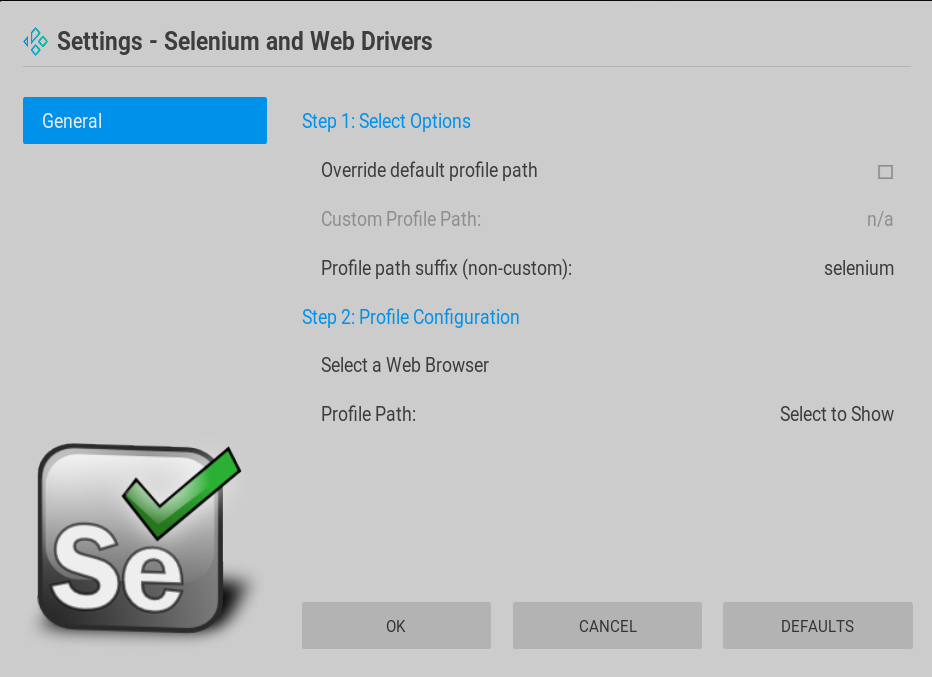
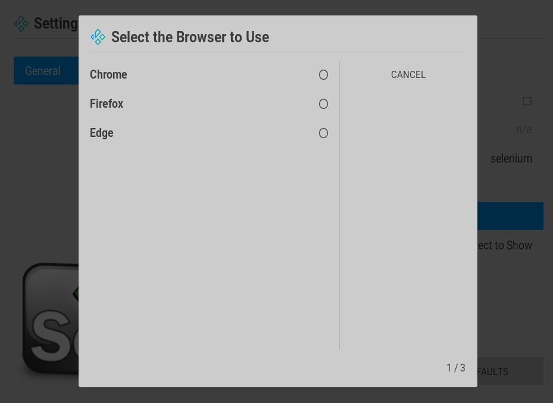
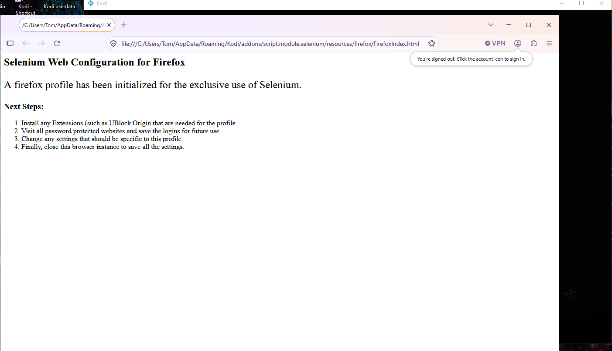
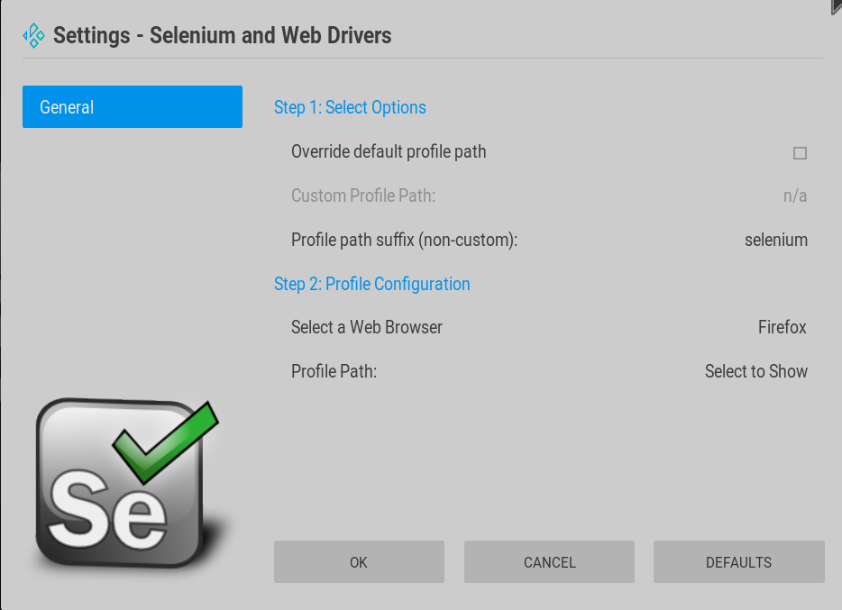
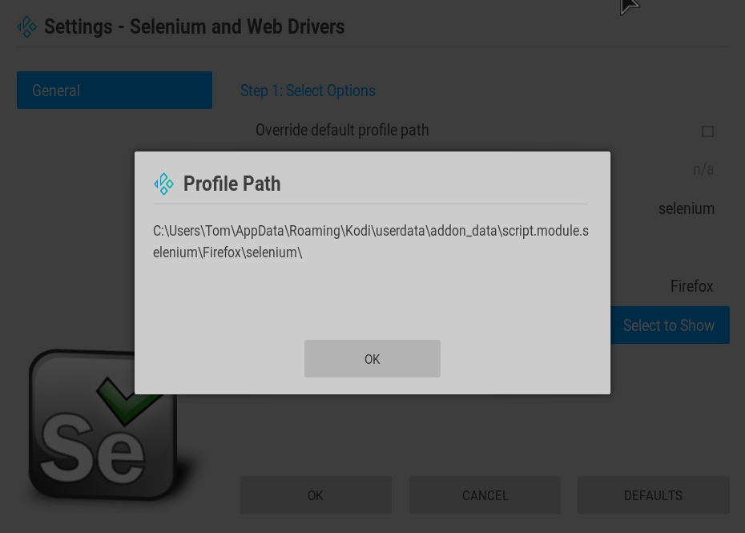

# Selenium automates browsers for KODI.

While this addon is just a library for use with other addons, it does interact with the web browser installed on the computer and requires specialized configuration of a web browser before it can be used.
This addon includes a custom setup routine, based on Kodi's settings.xml but extended using the guiSettings.py module. For this reason there is a user facing endpoint which places this module in the Programs addon category as well.

#### Installation in Kodi:

Note: This addon is a library and may be installed automatically as a dependency of another addon. 
The addon can also be installed prior to addons that depend on it if desired. The benefit of this approach is that the browser configuration can be setup before the library is needed.

##### Proactive Addon Installation

<u>Method 1: From the TJF Repository</u>

Repository link: https://fillimerica.github.io/kodirepo/

1. Enable "Unknown Sources" in Kodi Settings > System > Add-ons
2. Add the TJF Repository to the Kodi Sources in the Kodi File Manager
   1. Go to Settings > File manager
   2. Select "Add source" in either pane.
   3. Copy and paste (or type) the repository link listed above into the larger "Enter path..." edit box.
   4. In the smaller edit box under "Enter a name for this media source.", give the repository link a meaningful name such as "TJF Repository"
   5. Select OK to save this source.
3. Install the Repository as an add-on:
   1. Go to Settings > Add-ons
   2. Select "Install from zip file" (NOT install from repository at this point)
   3. In the "install from zip file" dialog, select the source that was added in step #2 above.
   4. A single zip file should appear in the list, select it to install the TJF Repository.
4. Install the Selenium add-on from the TJF Repository
   1. Go to Settings > Add-ons (if not already there)
   2. This time choose "Install from repository", and select the "TJF Repository" from the list.
   3. Choose "Program add-ons" from the category list.
   4. Choose "Selenium and Web Drivers" from the list. The Browser Launcher add-on will be installed.

<u>Method 2: From the Github Code Source</u>

Github Source link: https://github.com/Fillimerica/kodiaddon-script.module.selenium

1. From the github project repository, click on the green Code button and choose the "Download ZIP" option.
2. Depending on your browser configuration you may be prompted to choose a download location and/or a file name. In some configurations this is bypassed in favor of automatic downloading into a designated Downloads folder. In either case make sure the zip file that is downloaded is copied or moved into a location that Kodi can access in the Kodi File Manager.
3. Enable "Unknown Sources" in Kodi Settings > System > Add-ons
4. Install the Selenium and Web Drivers add-on:
   1. Go to Settings > Add-ons
   2. Select "Install from zip file"
   3. In the "install from zip file" dialog, select the zip file that was downloaded in step #2 above. Selenium and Web Drivers add-on will be installed.

### Configuration

*Note: While it is recommended that these configuration steps be completed prior to using any addons that depend upon this library, it is possible that an addon will recognize that initial configuration is required, and automatically initiate the setup steps prior to 1st use.*

1. From the Kodi Home Screen, go to Settings > Add-ons > My add-ons > Program add-ons.

2. Highlight the "Selenium and Web Drivers" entry, bring up the context menu and choose Settings, (or Select and then click on the Configure Icon). 

3. The main Settings dialog for the addon should appear:

   

4. By default, the browser profile for selenium will be automatically created in the Kodi userdata folder (Specifically in special://profile/addon_data/script.module.selenium/browserType/profilePathSuffix/) where:

   * "browserType" is the short name of the selected browser (i.e. Chrome,Firefox,Edge) 

   * "profilePathSuffix" is the text entered in the "Profile path suffix (non-custom):" field.

   If this path construction is not appropriate, it can be overridden in its entirety by selecting the "Override default profile path" checkbox, and then selecting a "Custom Profile Path".

5. After the options have been updated, next click on the "Select a Web Browser" button (or use the arrows and hit ENTER). A list of supported (but not necessarily installed) web browsers for the operating system will be displayed:

   

6. Select an appropriate browser from the list (one that is installed). The selection list will close and the browser profile will be built. After a few moments, the selected web browser should automatically open in the new profile with a default page that outlines the configuration steps that should be completed within the browser (such as adding extensions or saving login credentials):

   

7. Complete the steps inside the web browser. When finished close the web browser.

8. The configuration will be updated on-screen and the configured browser type will be listed to the right of "Select a Web Browser":

   

9. While not required, the exact profile path that was created can be viewed by clicking or selecting the "Profile Path: Select to Show" button. That option will open an informational dialog box showing the full configured path. Click OK to close the dialog:

   

10. Changes to the configuration are not saved in the addon until the OK button is selected. Click or select the OK button to close the settings dialog and save the changes. Configuration is complete.

    Other buttons on the Settings screen:

    * Cancel - This closes the Settings dialog **without** saving the changes to the addon. However, if a web browser was already selected in step #6 it will remain on the file system and will have to be erased manually if desired.
      If the same web browser is selected and a profile was already created it will be re-used.

    * Defaults - This resets the settings to their defaults. Which is:
      Use the default profile path, with a suffix (ending folder name of) "selenium".
      The Selected browser type is defaulted to none (ready for a new selection)
      *The "defaults" are meant to reset the configuration, not to create a usable one. After choosing "Defaults" the configuration must be completed and saved with OK to take effect.*
